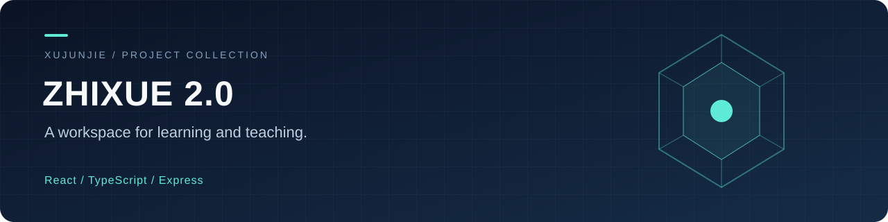
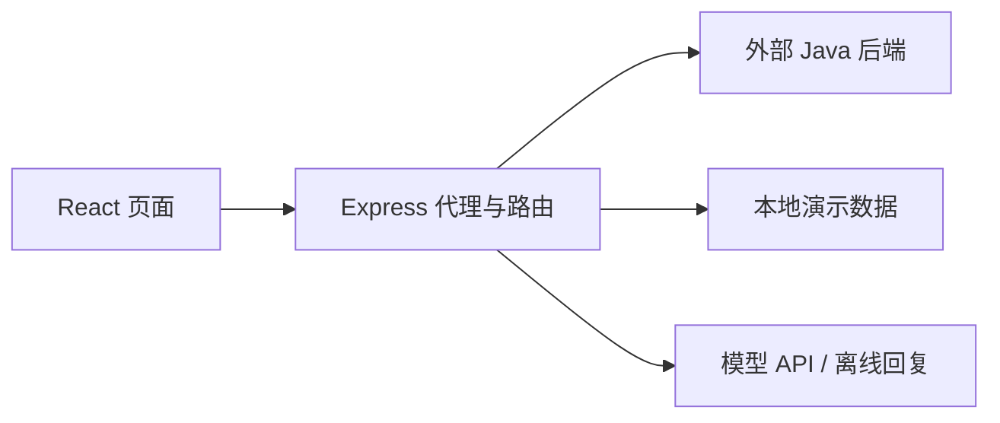

# 智学平台 2.0
> 面向学生与教师的学习平台 Web 工程，包含课程、考试、学情分析和 AI 助手交互。

**React 19 · TypeScript · Vite · Express · Tailwind CSS**

## 项目定位

本仓库以 React 组件组织学习与教学场景，使用 Express 提供 API 代理和部分演示接口，适合展示多角色界面、状态管理和前后端联调设计。完整 Java 后端不包含在本仓库内。

## 功能导览

| 场景 | 页面与模块 |
| --- | --- |
| 学生学习 | 首页、课程、学习详情、个人空间与错题 |
| 考试与反馈 | 考试界面、学习报告与学习行为展示 |
| 教师教学 | 教师工作台、班级报告、学生分析、题库与试卷管理 |
| AI 助手 | 服务端对接模型 API；未配置密钥时有规则式离线回复 |

## 实现亮点

- **组件化页面组织**：学生和教师页面集中在 [src/components/](src/components/)，由 [App.tsx](src/App.tsx) 协调视图和共享状态。
- **接口适配层**：[server.ts](server.ts) 将前端路径映射到后端接口，并处理部分响应结构。
- **演示数据回退**：后端请求异常或部分状态下，继续进入本地 Mock 路由；数据定义位于 [serverMockData.ts](serverMockData.ts)。
- **类型与交互**：[types.ts](src/types.ts) 提供领域类型，配合 React、Tailwind CSS 与 Motion 组织界面。



## 本地运行

需要可运行项目工具链的 Node.js 环境。依赖清单与锁定版本分别见 [package.json](package.json) 和 `package-lock.json`。依赖准备完成后：

```bash
npm run dev
```

默认服务地址为 `http://localhost:3000`。

- 服务端使用 `dotenv.config()` 默认读取 `.env`，变量说明见 [.env.example](.env.example)。模型密钥使用 `GEMINI_API_KEY`。
- 真实后端目标目前写在 `server.ts` 中；联调前需调整为自己的后端地址。
- 未配置模型密钥时的回复是规则式演示，不代表真实模型推理。
- 登录等接口不具备完整的本地 Mock 覆盖，不能保证脱离后端完成全部业务流程。

## 项目命令

| 命令 | 作用 |
| --- | --- |
| `npm run dev` | 启动 Express 与 Vite 开发服务 |
| `npm run lint` | TypeScript 类型检查 |
| `npm run build` | 构建前端并打包服务端入口 |
| `npm start` | 运行构建后的服务端 |

## 演示与讲解

建议围绕“课程学习 → 错题与报告 → 教师学情”的页面链路展示，并结合 API 代理说明真实数据与演示数据的边界。本仓库与 A3 完整工程分别维护，不能据此认定两者代码同步。

## 授权与依赖

根目录尚未声明项目许可证，第三方图片与依赖不因仓库公开而获得额外授权。现有锁文件中的 `lucide-react 0.546.0` 标记为 ISC；依赖许可需要单独核实和处理。
